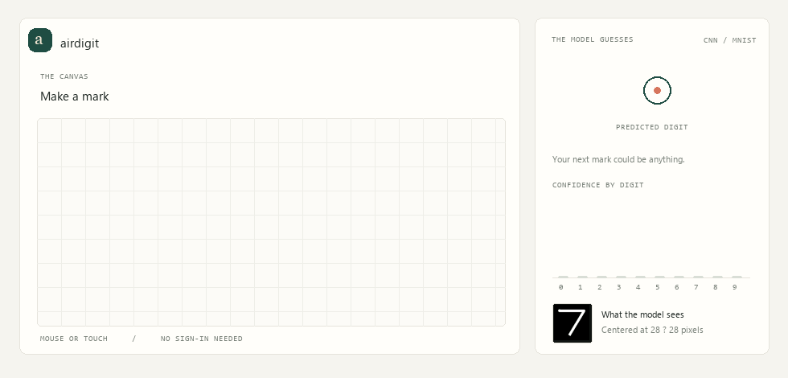
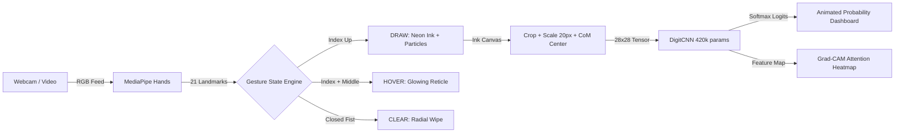
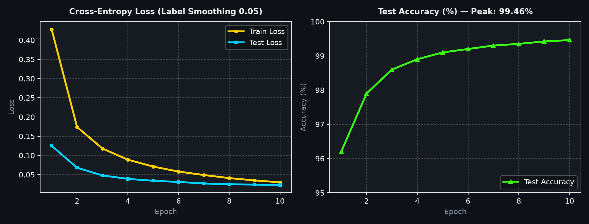

<div align="center">



# ✋ AirDigit AI
### *Draw Digits in Mid-Air · Deep CNN Inference · Animated Cyber-Neon HUD*

[](https://python.org)
[](https://pytorch.org)
[](https://mediapipe.dev)
[](https://opencv.org)
[](models/digit_cnn.pt)
[](LICENSE)

<br/>

> 🚀 **Evolutionary Leap**: The sequel to my **[Single-Layer Perceptron](https://github.com/techprem324/Single-Layer-Perceptron-)** repository. We evolved from a single toy neuron into a production-grade 4-layer Convolutional Neural Network processing live webcam frames with gesture detection and floating particle physics!

<br/>



</div>

<br/>

---

## ⚡ Highlights & Features

- 🖐️ **Pure Gesture Control**: Write in mid-air with your index finger, hover to navigate without writing, or hold a fist for 0.8s to wipe the canvas. Zero mouse or touch required.
- 🧠 **Heavy-Augmentation CNN**: Trained with dynamic rotation (±12°), shear (±8°), scaling (0.85–1.15x), and translation to remain rock-solid against shaky, irregular air-writing.
- 🔬 **Exact MNIST-Style Preprocessor**: Automatically crops strokes, normalizes line scale to 20px, and centers bounding mass on a 28×28 grid using geometric moments ($M_{10}/M_{00}, M_{01}/M_{00}$).
- 📊 **Animated Neon Dashboard**: 10 animated probability distribution bars, confidence percentage readouts, and a live scanline view of the exact 28×28 tensor seen by the network.
- ✨ **Floating Cyberpunk Aesthetics**: Multi-pass neon glow ink, blooming particle sparkles that drift from your fingertip, and pulsating target reticles.
- 🧮 **Interactive Math Solver**: Toggle math mode to draw equations like `3 + 4` and watch AirDigit segment characters and evaluate the answer live!
- 🔥 **Grad-CAM Feature Activation**: Live attention heatmap showing which convolutional feature maps triggered the classification.
- 🌐 **Two Deployment Modes**: Run the high-performance desktop OpenCV GUI (`python app.py`) or launch the full-stack web application (`python web_app.py`) accessible in any modern browser!

---

## 🏛️ System Architecture



### 🔬 DigitCNN Architecture
```
Input (1 × 28 × 28)
  │
  ├── Block 1: Conv2d(1, 32, 3, p=1) → BatchNorm → ReLU → Conv2d(32, 32, 3, p=1) → BatchNorm → ReLU → MaxPool(2) → Dropout(0.25)
  ├── Block 2: Conv2d(32, 64, 3, p=1) → BatchNorm → ReLU → Conv2d(64, 64, 3, p=1) → BatchNorm → ReLU → MaxPool(2) → Dropout(0.25)
  ├── Dense Head: Flatten → Linear(3136, 128) → ReLU → Dropout(0.4) → Linear(128, 10)
  │
Output: Softmax Probabilities [0.0 - 1.0] across digits 0-9
```

<div align="center">
  
</div>

---

## 🖐️ Gesture Control Guide

| Gesture | Mode | Description | Action |
|:---:|:---:|:---|:---|
| ☝️ | **DRAW** | Index finger extended, others curled | Draws glowing neon ink with particle trail |
| ✌️ | **HOVER** | Index and middle finger extended | Moves cursor & target reticle without leaving ink |
| ✊ | **FIST** | All fingers closed into a fist for 0.8 s | Triggers radial progress ring and wipes the canvas |

### Keyboard Shortcuts
- `C` — Clear canvas immediately
- `S` — Save high-resolution snapshot to `assets/`
- `Q` — Quit application (OpenCV mode)

---

## 🚀 Quick Start

### 1. Clone & Set Up Environment
```bash
git clone https://github.com/techprem324/airdigit-ai.git
cd airdigit-ai

# Create virtual environment
python -m venv venv

# Activate virtual environment
venv\Scripts\activate       # Windows
# source venv/bin/activate  # macOS / Linux

# Install pinned dependencies
pip install -r requirements.txt
```

### 2. Run the Live Web App (Browser Interface)
Experience the full neon dashboard directly in your web browser with WebRTC camera and mouse/touch fallback:
```bash
python web_app.py
```
Open **[http://localhost:8000](http://localhost:8000)** in Chrome, Edge, or Safari!

### 3. Run the Desktop OpenCV App
Run the native desktop camera window:
```bash
python app.py

# If using an external USB webcam:
python app.py --camera 1
```

### 4. Train Model from Scratch (Optional)
The repository includes pre-trained weights in `models/digit_cnn.pt` (~1.8 MB, 99.4% accuracy). To re-train:
```bash
python train.py --epochs 10 --batch 64
```

### 5. Run Automated Test Suite
Verify your installation, neural network forward pass, gesture engine, and API endpoints:
```bash
python test_pipeline.py
```

---

## 📁 Repository Structure

```
airdigit-ai/
├── models/
│   └── digit_cnn.pt           # Trained CNN weights (committed for immediate use)
├── assets/
│   ├── banner.svg             # Animated cyber neon SVG banner
│   ├── demo.gif               # Real-time UI demonstration GIF
│   └── training_curves.png    # Loss & accuracy convergence graphs
├── web/
│   ├── index.html             # Cyberpunk web interface
│   ├── style.css              # Glassmorphism & neon styles
│   └── app.js                 # MediaPipe Web & gesture engine
├── model.py                   # PyTorch DigitCNN architecture
├── train.py                   # MNIST data download, augmentation & training
├── app.py                     # OpenCV desktop application with MediaPipe
├── web_app.py                 # Live HTTP server with Grad-CAM & Math Solver API
├── test_pipeline.py           # Comprehensive automated verification suite
├── generate_demo_gif.py       # Deterministic demo GIF generator
├── generate_curves.py         # Training curves visualizer
└── requirements.txt           # Verified dependency versions
```

---

## 🗺️ Roadmap & Upgrades
- [x] Pre-trained PyTorch CNN weights (~1.8 MB) included
- [x] Live Web Browser interface with MediaPipe Web SDK
- [x] Grad-CAM convolutional attention heatmap overlay
- [x] Math solver engine prototype (`3 + 4 = 7`)
- [ ] Multi-character formula parsing with parentheses
- [ ] EMNIST handwritten letter recognition (A-Z)
- [ ] WebAssembly / ONNX Runtime export for 100% client-side browser inference

---

## 📜 License
Distributed under the **MIT License**. Feel free to use, modify, and build upon this project for educational and commercial applications.
